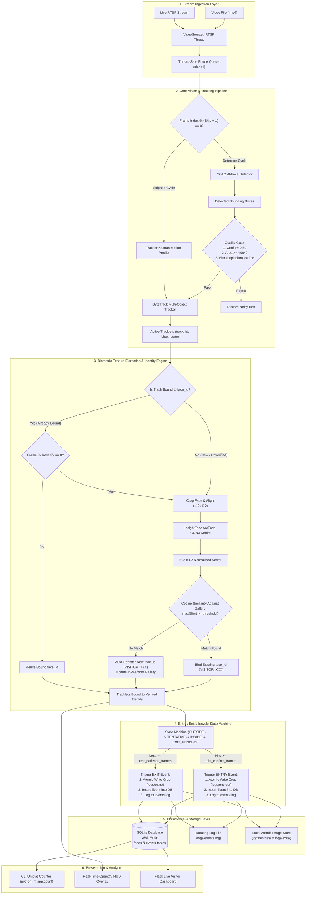
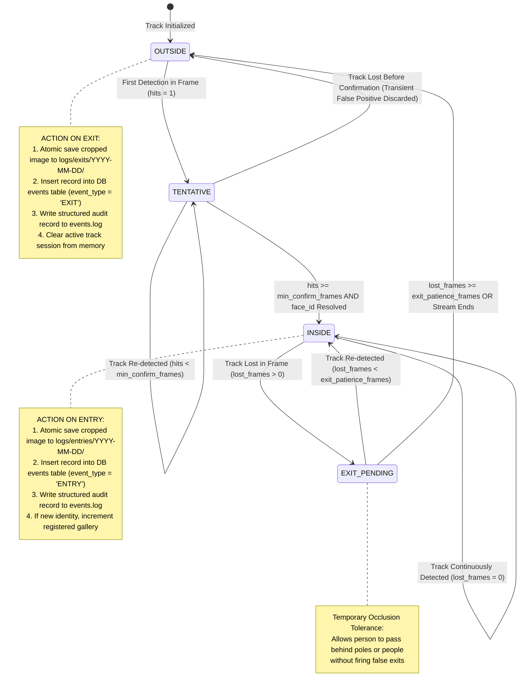
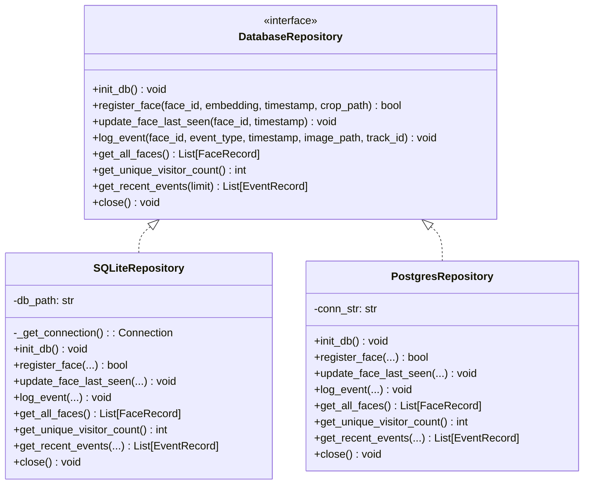
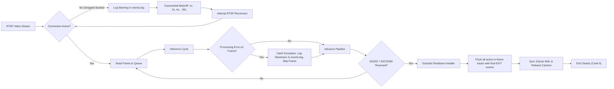

# System Architecture Specification
## Intelligent Face Tracker with Auto-Registration and Unique Visitor Counting

---

## 1. High-Level System Architecture

The following diagram illustrates the end-to-end data processing pipeline, from frame ingestion to biometric feature extraction, state tracking, and persistence:

---

## 2. Entry / Exit Lifecycle State Machine

To eliminate duplicate event logging and guarantee exactly **one Entry** and **one Exit** per physical encounter, each detected face track is governed by a finite state machine:

---

## 3. Storage Layer & Repository Pattern

The persistence tier decouples the database engine from the business logic using the **Repository Pattern**. This allows swapping SQLite for PostgreSQL or MongoDB with zero pipeline changes:

### Database Schema Definition:
* **Table `faces`**:
  * `face_id` TEXT PRIMARY KEY (e.g., `VISITOR_001`)
  * `embedding` BLOB NOT NULL (512 float32 binary buffer)
  * `first_seen` TEXT NOT NULL (ISO-8601 UTC timestamp)
  * `last_seen` TEXT NOT NULL (ISO-8601 UTC timestamp)
  * `visit_count` INTEGER DEFAULT 1
  * `first_crop_path` TEXT
* **Table `events`**:
  * `event_id` INTEGER PRIMARY KEY AUTOINCREMENT
  * `face_id` TEXT NOT NULL (Foreign Key -> `faces.face_id`)
  * `event_type` TEXT NOT NULL (`ENTRY` | `EXIT`)
  * `timestamp` TEXT NOT NULL (ISO-8601 UTC timestamp)
  * `image_path` TEXT NOT NULL
  * `track_id` INTEGER NOT NULL
* **Indexes**:
  * `idx_events_face_id` ON `events(face_id)`
  * `idx_events_timestamp` ON `events(timestamp)`

---

## 4. Pipeline Resilience & Fault Recovery

